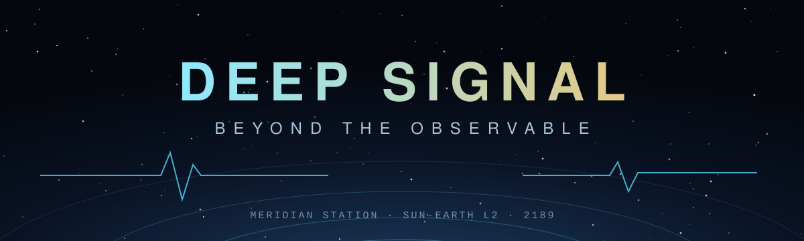

<div align="center">



### *Observe the real universe. Investigate the unknown. Decide what counts as a discovery.*


**[Run it](#-run-it) · [What you do](#-what-you-do) · [Real vs fictional](#-real-vs-fictional-the-core-rule) · [Roadmap status](#-the-five-versions) · [Honest limits](#-honest-limits)**

</div>

---

## 🛰️ The pitch

It is **2189**. You command **Meridian Station**, a deep-space observatory at the Sun–Earth L2 point. Point real instruments at real objects, turn raw data into research, run missions for Earth Mission Control, and keep a crew alive while you do it.

Then something in the data doesn't add up.

What begins as an observatory sim grows, in one continuous universe and one continuous save, into a civilization that surveys the galaxy, plants colonies at other stars, and chases mysteries that may or may not have an explanation. **There is no final boss.** There are eras, and the universe keeps going after each one.

## 🔭 What you do

| | |
|---|---|
| **Observe** | Optical and radio observation of 59+ real catalogue objects, pulsars, clusters, asteroids and comets. Buy better instruments. Noise, completeness and reliability are tracked on every dataset. |
| **Research** | 62 technologies in a visual tree with data requirements, from basic optics to wormhole theory. Each is labelled real, simulated, speculative or fictional. |
| **Command** | Crew with specialisations and training, station modules, power and life support, a fleet you can design and build, 8-stage expeditions with risk and recovery. |
| **Answer to Earth** | Contracts, emergency missions, budget allocation, monthly finance, publications and peer review. |
| **Investigate** | Anomalies are staged investigations. Evidence is noisy and can conflict. You propose hypotheses, set a confidence, conclude, and may be proven wrong later. |
| **Expand** | Planetary exploration, relays, factories, mines, outposts, interstellar precursor probes, a galactic map of 48 sectors out to 8,000 ly, and colonies that fail if you can't supply them. |
| **Listen** | Decode signals from unknown civilizations (fictional), exchange messages across light-delay, and face decisions with real consequences. |
| **Remember** | A permanent searchable timeline, an archive, achievements and eras, and a Universe Memory summary. |

## 🧭 Real vs fictional: the core rule

Everything on screen is labelled. No exceptions.

| Label | Meaning |
|---|---|
| 🟢 **REAL** | Astronomy catalogue data (stars, pulsars, clusters, small bodies). Missing values show `DATA UNKNOWN`, never a made-up number. |
| 🔵 **SIMULATED** | Game mechanics modelled on real science: planet ratings, economics, signal delay, colony supply. |
| 🟣 **SPECULATIVE** | Plausible but unproven science: precursor probes, fusion and antimatter drives, wormhole theory. |
| 🔴 **FICTIONAL** | Invented story content: unknown civilizations, mysteries, procedural star systems, the 2189 setting. |

## 🚀 Run it

No build step. No dependencies. Needs only a static server (the game loads JSON and ES modules, so `file://` will not work).

```bash
git clone https://github.com/luciferalive/DEEP-SIGNAL-BEYOND-THE-OBSERVABLE.git
cd DEEP-SIGNAL-BEYOND-THE-OBSERVABLE
python3 -m http.server 8000      # or: npm start
# open http://localhost:8000
```

```bash
npm test                         # 77 engine tests, Node 18+
```

## 🗺️ The five versions

One universe, one save lineage. Saves from every earlier version still load, with an automatic backup made before any migration.

| Version | Theme | Highlights |
|---|---|---|
| **V1** | The Observatory | 14 sections, game clock, real catalogue, optical/radio observation, labs, crew, station, missions, archive |
| **V2** | The Living Universe | Scheduler and speed ladder, fleet and expeditions, 43 technologies, instruments, anomaly investigation, Earth contracts, finance |
| **V3** | Beyond Human Limits | Planetary stages, facilities, ship design, interstellar probes, civilization index and policies |
| **V4** | The Unknown | Persistent mystery engine, hypotheses, anomaly network, decisions, rare events, unknown civilizations |
| **V5** | Beyond the Observable | Galactic map, colonies, networks, cosmic intelligence, achievements, procedural mysteries |

<details>
<summary><b>V5 in detail</b></summary>

- **Galactic Map:** 8 rings × 6 sectors out to 8,000 ly. Survey range grows with technology. Real stars plus deterministic procedural FICTIONAL systems, seeded per save.
- **Interstellar Civilization:** station, mine, hub and relay colonies up to 150 ly, years of transit with 10% loss, supply and sustainability, failure when starved. Five network priorities.
- **Cosmic Intelligence:** decode signals to reveal lore, study alien technology for a data-yield bonus.
- **Frontier:** 10 achievements, eras, unlimited method refinement, procedurally generated mysteries, chronicle compaction.

</details>

## ⚙️ Under the hood

- **Deterministic, DOM-free engine.** Seeded RNG (mulberry32), a 600 s tick and an event scheduler. The engine runs in Node with no browser.
- **Pure views.** Each section is a `render(ui)` function; one delegated event handler drives all actions.
- **Safe saves.** Format v7, validated on load, stepwise migrations, automatic backup before upgrading, recovery to the newest readable save.
- **Tested against real history.** Migration tests use genuine saves written by the V1 to V6 engines, plus a 3-year deterministic run and a test that renders every view.
- **Fast.** About 0.8 s to simulate a year; saves around 200 KB.

```
index.html          entry point
css/                tokens, layout, components
data/               JSON: real astronomy + game content
js/                 DOM-free engine modules (tested in Node)
js/views/           one module per navigation section
js/ui-manager.js    router, actions, saves, modals
tests/              engine tests and real save fixtures
```

## ⚠️ Honest limits

- Astronomy values were compiled from published catalogues from memory and are **not** re-verified against live archives (`last_verified` is `null`).
- Colonies are capped at 150 ly; networks are aggregate, with no per-ship fleet simulation.
- Gameplay numbers are hand-tuned; balance beyond about 3 simulated years is lightly tested.
- Browser testing was Chromium only; mobile was checked in an emulator at 390 px; accessibility is basic.
- No multiplayer or combat.

Per-version "not done" lists are in `CHANGELOG.md` and `DEVELOPMENT_ROADMAP.md`.

## 📚 Docs

[`CHANGELOG.md`](CHANGELOG.md) · [`ARCHITECTURE.md`](ARCHITECTURE.md) · [`SYSTEMS.md`](SYSTEMS.md) · [`DEVELOPMENT_ROADMAP.md`](DEVELOPMENT_ROADMAP.md) · [`DATA_SOURCES.md`](DATA_SOURCES.md)

---

<div align="center">

</div>
